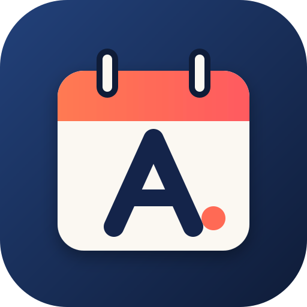

# AgendApp



Agenda personale chiara e dettagliata: calendario, appuntamenti, scadenze, pagamenti, compleanni, note e promemoria a schermo intero.
Funziona nel browser e si installa sul telefono come una vera app (PWA), anche offline.

## Funzioni

- **Calendario** con vista **settimanale, mensile e annuale**. Tocca un giorno per aprirlo: vedi tutti gli impegni, ne aggiungi di nuovi e scrivi gli **appunti del giorno**. Scorri a destra o a sinistra per cambiare periodo.
- **Festività italiane** segnate in rosso (comprese Pasqua e Pasquetta).
- **Tipologie**: Appuntamenti, Scadenze, Pagamenti (con importo e totali del mese/anno), Compleanni (con l'età), Note.
- **Aree della vita**: Personale, Lavoro, Salute, Mezzi, Casa, Famiglia e amici, Svago, Sport, Studio, Animali, Finanze, Altro.
- **Mezzi**: registra auto, moto, camper, furgone, barca e bicicletta, con targa. Per ogni mezzo hai i modelli rapidi (assicurazione, bollo, revisione, tagliando, gomme, rimessaggio…).
- **Ripetizioni**: ogni giorno, settimana, 2 settimane, mese, 2/3/6 mesi, anno, 2 anni, con data di fine.
- **Notifiche personalizzabili per ogni elemento**:
  - tipo di avviso: *schermo intero*, *banner* o *discreta*;
  - quando: all'ora, 5/15/30 minuti, 1/2 ore, 1/2/3 giorni, 1/2 settimane, 1 mese prima (anche più di uno);
  - suono e vibrazione attivabili;
  - posticipa di 5 min, 15 min, 1 ora o a domani; segna come fatto/pagato direttamente dall'avviso.
  - Valori predefiniti per tipologia nelle Impostazioni.
- **Centro notifiche** con lo storico degli avvisi.
- **Prossimi impegni**: riepilogo di oggi, settimana, importi da pagare, elementi in ritardo e ricerca.
- **Tema** chiaro, scuro o automatico.
- **Backup** (esporta/importa JSON) ed **esportazione calendario .ics** per Google Calendar, Apple Calendario e Outlook.

## Pubblicazione con GitHub Pages

1. Nel repository: **Settings → Pages**.
2. *Source*: **Deploy from a branch**, branch **main**, cartella **/ (root)** → Save.
3. Dopo un minuto l'app è online all'indirizzo `https://<utente>.github.io/<repository>/`.

Per installarla sul telefono: aprila con Chrome (Android) o Safari (iPhone) → menu → **Aggiungi a schermata Home**.

## Note sulle notifiche

I dati e i promemoria restano sul dispositivo. Gli avvisi arrivano quando AgendApp è aperta o in secondo piano;
con le *Notifiche di sistema* attive (Impostazioni) compaiono anche come notifiche del telefono mentre l'app è in background.
Con l'app completamente chiusa il browser non può svegliarla da solo: per quel caso è previsto un aggiornamento futuro
(server push o sincronizzazione con Google Calendar tramite l'esportazione .ics).

## Struttura

```
index.html            pagina principale
css/style.css         grafica
js/app.js             logica (calendario, sezioni, notifiche, dati)
sw.js                 service worker (offline e clic sulle notifiche)
manifest.webmanifest  installazione come app
icons/                logo e icone
```
